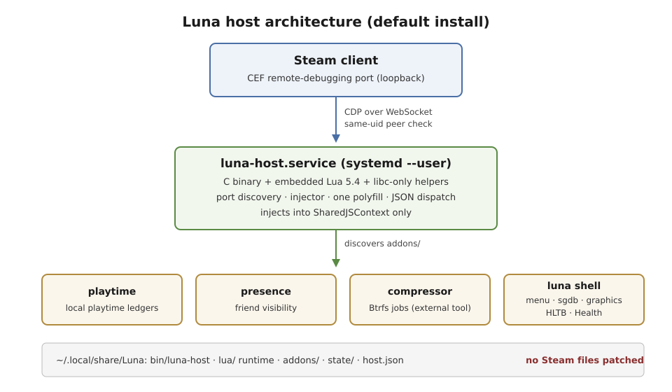

# Luna

Steam panels for Linux, installed as one user service.

[](https://github.com/pgm1207/Luna)
[](THIRD_PARTY_NOTICES.md)

Luna adds panels to the Steam client on Linux: playtime, presence, compression,
artwork, graphics information, HowLongToBeat times and diagnostics. It runs as a
single systemd user service, `luna-host`, which attaches to Steam through Steam's
own remote-debugging port. Luna does not patch the Steam client or any Steam
file. It is an independent integration project, not a fork of Steam or of the
upstream plugin runtimes it can work alongside.

## Screenshots

Screenshots are taken from a clean install: default Steam, no themes, nothing
installed except Luna. They are stored as `docs/img/*.png`; the image files are
not part of this repository snapshot. No mockups are used.

The diagram below is `docs/img/architecture.svg`:



## Features

| Feature | Status | What it does |
| --- | --- | --- |
| Luna menu | Available | One Steam menu entry that holds the Luna pages |
| Playtime | Available | Tracks and edits local playtime for shortcuts and non-Steam games |
| Presence | Available | Shows selected non-Steam activity to friends |
| Compressor | Available | Runs and monitors Btrfs game-compression jobs; needs the separate [btrfs-game-compressor](https://github.com/pgm1207/btrfs-game-compressor) tool |
| SteamGridDB artwork | Beta | Right-click a game, then Change artwork: grid, wide, hero, logo and icon, with backup and restore |
| Graphics | Beta, read-only | Reports GPU, driver, kernel, the `lsfg-vk` layer and OptiScaler installs; installs nothing |
| HowLongToBeat | Available | Local cached times, a HowLongToBeat tab and library sort with capsule hours |
| Health and diagnostics | Available | Installed versions against the pinned bundle, host and Steam paths, settings and data files, Copy diagnostics |
| SteamOS Mode shortcuts | Available | Big Picture shortcuts per detected display; Gamescope is a separate system package |

The HowLongToBeat game-page cell was removed; the tab and library sort remain.
The Graphics page does not install drivers or upscalers. The Compressor page does
not install its external tool.

## What Luna does not do

- **No game unlocking.** Luna does not unlock games, change ownership, bypass
  licences or alter DRM. It does not touch game manifests or game files.
- **No Steam client patching.** Luna never edits, patches or replaces the Steam
  client, `steamwebhelper` or Steam's package files. Attaching over the debugging
  port is the whole mechanism.
- **No automatic Steam client pin.** A plain `luna install` leaves the installed
  Steam client exactly as it is. Pinning or rolling back the client is a separate
  opt-in path, described with the second install line below; it is never done
  silently.
- **No upstream replacement.** Luna is not a fork of the plugin host or native
  integration projects it can use, and it does not ship their source.

## Install

Steam must be fully closed (Steam → Exit) before installing or uninstalling.

Default install, Luna's own host, nothing else required:

```bash
curl -fsSL https://raw.githubusercontent.com/pgm1207/Luna/main/install.sh | bash
```

Opt in to the full pipeline (pins the Steam client, installs the pinned upstream
base, then Luna on top):

```bash
curl -fsSL https://raw.githubusercontent.com/pgm1207/Luna/main/install.sh | bash -s -- --lumen
```

From a checkout instead:

```bash
git clone https://github.com/pgm1207/Luna.git
cd Luna
bash install.sh --dry-run   # print the plan; writes nothing
bash install.sh
```

`--dry-run` works on both the one-liner (`bash -s -- --dry-run`) and the
checkout. `--only NAME`, `--force` and `--no-system-packages` are listed by
`bash install.sh --help`.

A plain install on a machine that already has a third-party host keeps that host
and the Steam client as they are and only refreshes Luna's add-ons. Moving to
Luna's own host from there is an explicit `luna host cutover`.

Uninstall:

```bash
luna uninstall
```

`luna uninstall --only NAME` removes one add-on. User data (playtime ledgers,
presence settings, HowLongToBeat cache, preferences) lives outside the add-on
directories and is not removed. Restart Steam afterwards.

After installing, restart Steam so the Luna menu entry appears.

## Requirements

- Linux with a **native Steam** install for the current user. Flatpak Steam is
  detected and refused.
- **Steam fully closed** during install and uninstall.
- `bash` and `python3`. `curl` only for the one-liner.
- `cc` and `make` at install time, to build `luna-host` from `host/`. Release
  bundles carry the prebuilt binary, so a bundle update does not need a compiler.
- A working **systemd user session**; the host is `luna-host.service`.
- Network access for the initial download and for distro packages.
- Do not run as root. `sudo` is used only for system packages, and only on an
  interactive terminal.

The opt-in path (the second install line) additionally needs network access to
the pinned upstream installer and Steam client packages, plus `git`, `curl`,
`jq`, `tar` and `unzip` (the package step installs them when missing). It rolls
the Steam client back to a pinned build and hard-locks it.

Steam is installed through the distro package manager if it is missing
(`pacman`, `apt` or `dnf`). GPU drivers are never installed by Luna.

## Command line

`luna` is installed to `~/.local/bin/luna`; `python3 scripts/luna.py` is the same
tool from a checkout.

| Command | Purpose |
| --- | --- |
| `luna preflight` | Read-only environment report, including the active host |
| `luna status` | What is installed and whether it matches the pinned payloads |
| `luna doctor` | Health report: host, Steam paths, update block, bridge, launch options |
| `luna install [--dry-run] [--force]` | Install or repair the add-ons on the active host |
| `luna uninstall [--only NAME]` | Remove Luna, or one add-on |
| `luna verify [--sources]` | Verify manifest, payloads and drift |
| `luna host status\|cutover\|rollback` | Show or switch the plugin host (Steam closed) |
| `luna update --latest` | Install the newest verified bundle |
| `luna update-all [--dry-run]` | Update the add-ons and re-check the base |
| `luna steam status\|heal\|launchopts` | Inspect the Steam client, restore an update block, find stale launch options |
| `luna backup` / `luna restore ARCHIVE` | Snapshot or restore Luna user data |
| `luna reconcile [--dry-run]` | Merge Syncthing copies of Steam's `localconfig.vdf` |
| `luna timer on\|off\|status` | The unattended update timer |

The opt-in host pipeline and its update commands are documented in
[`docs/LUMEN.md`](docs/LUMEN.md).

## Troubleshooting

**The Luna panels do not appear.**

1. Exit Steam completely and start it again. Panels attach after Steam has
   created its CEF context.
2. Run `luna doctor` and `luna host status`. They report the active host, the
   add-on versions and the unit state.
3. `systemctl --user status luna-host.service` shows whether the host is running;
   `systemctl --user restart luna-host.service` restarts it.
4. If the binary is missing, `luna install --force` rebuilds and reinstalls it
   (Steam closed). `luna verify` checks the payloads.

**The debugging port changed.**

Luna does not assume a fixed port. `luna-host` reads Steam's own
`--remote-debugging-port=` value from the Steam client or `steamwebhelper`
command line, verifies that the process belongs to the same user, and attaches
there. If Steam restarts with a different port, restart `luna-host.service` or
wait for its next discovery pass. A second Steam session for another user is not
attached to.

**Steam updated itself.**

A plain install does not pin the client, so Steam updates normally. An update can
change the debugging port or the UI code Luna attaches to; restart Steam and the
host, then run `luna doctor`. Luna does not re-patch anything after a Steam
update because it never patched the client in the first place. If panels are
still missing after a restart, update Luna (`luna update --latest`).

**Which host is active?**

`luna status` prints `host: luna (standalone)` when Luna's own host is active and
`host: lumen` when a third-party host is active. `luna host cutover` switches to
luna-host and `luna host rollback` switches back; both require Steam closed. A
plain install never changes an existing third-party host by itself.

## How it works

```text
Steam client
└── CEF remote-debugging port
    └── luna-host (systemd --user, one per login)
        ├── luna-host binary   C, embeds Lua 5.4 and a small libc-only helper library
        ├── Lua runtime        port discovery, CDP session, injector, RPC dispatch
        └── addons/            playtime, presence, compressor, sgdb, graphics, luna
```

- **C plus Lua host.** `host/` builds one binary, `luna-host`, from C and an
  embedded Lua 5.4. C provides filesystem, process, socket and hashing helpers;
  the Lua tree in `host/lua/luna/` provides the loop, injector, RPC layer and
  add-on loader. One systemd user unit runs it.
- **CDP attach.** `luna-host` finds Steam's Chrome DevTools Protocol endpoint,
  checks the peer is a Steam process owned by the same user, and opens a
  WebSocket session. It injects into the Steam `SharedJSContext`, the context
  that has `SteamClient`.
- **One polyfill.** The page receives a single
  `window.Millennium.callServerMethod` polyfill backed by a `Runtime.addBinding`
  channel (`__lunaSend`) and a per-connection token. There is one bridge, not one
  per add-on.
- **JSON dispatch.** A call is JSON sent over the binding; `luna-host` validates
  it, dispatches it to the add-on's registered Lua function and returns a JSON
  string that resolves the page promise. Add-ons do not get native code access.
- **No client patching.** Nothing in the default path edits Steam files,
  `boot.lua`, `steam.cfg`, game manifests or the client. Removing Luna is
  removing the unit and the add-on directory.

## Development

```bash
bash scripts/test-all.sh                  # UI, backends and installer tests
python3 scripts/luna.py verify --sources  # also compare with local checkouts
make -C host test                         # luna-host runtime and CDP tests
```

Hosted GitHub Actions is not used as a release gate here; the local
`test-all.sh` run is. See [CONTRIBUTING.md](CONTRIBUTING.md),
[docs/ARCHITECTURE.md](docs/ARCHITECTURE.md) and
[THIRD_PARTY_NOTICES.md](THIRD_PARTY_NOTICES.md).

## License

This repository contains no license file, so Luna's original code is not
currently offered under an open-source license. No license is claimed by this
README. The third-party components Luna installs or interoperates with keep
their own licenses; provenance and the licence status checked for each are in
[THIRD_PARTY_NOTICES.md](THIRD_PARTY_NOTICES.md). Do not redistribute this
repository or a bundle built from it without settling that first.
